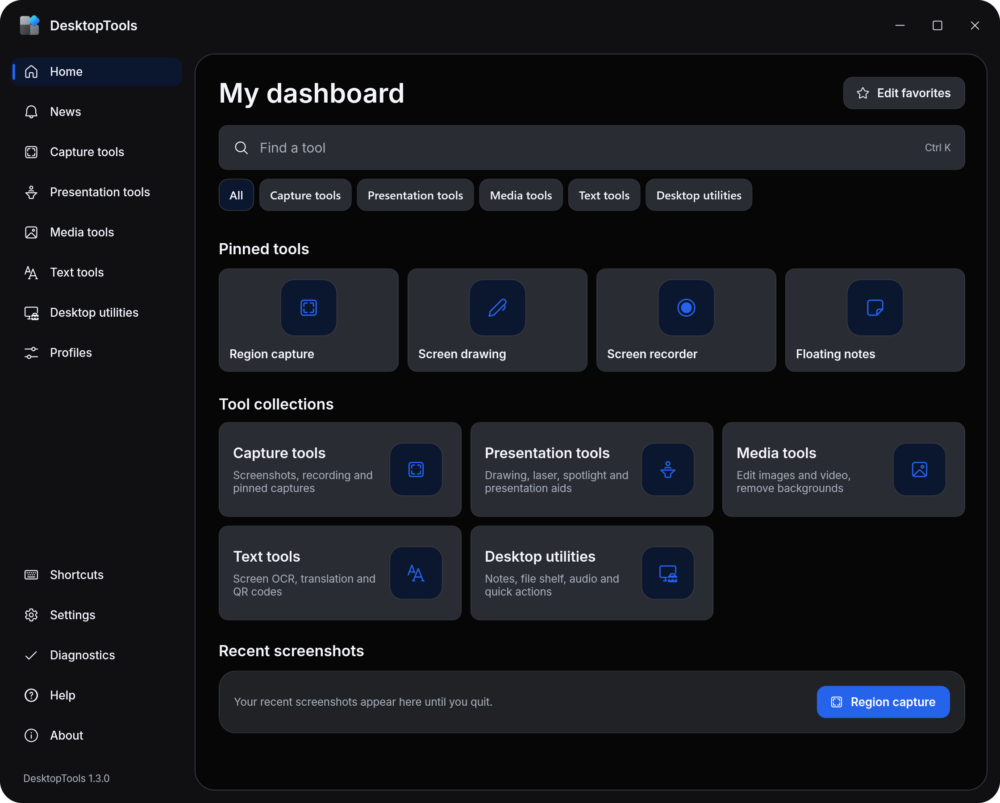
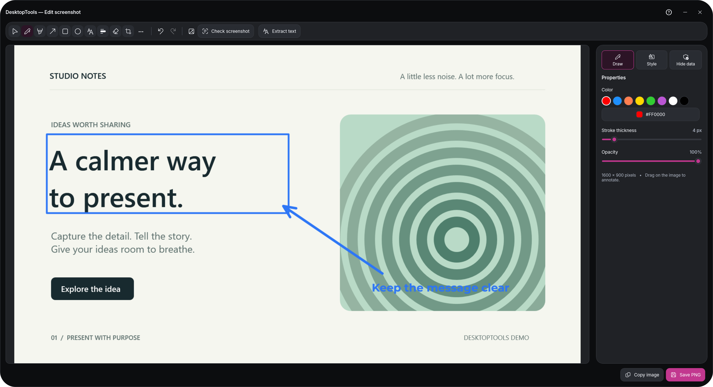
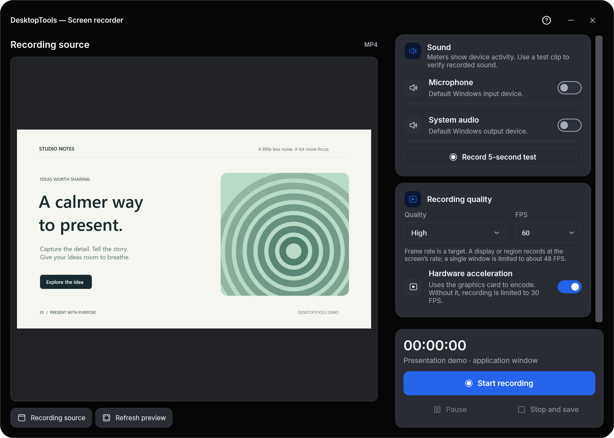

# DesktopTools


[English](README.md) · [Русский](README.ru.md) · [Deutsch](README.de.md) · [Français](README.fr.md) · [Español](README.es.md)

⭐ **Du hast deine Werkzeuge gern an einem Ort? [Gib DesktopTools einen Stern auf GitHub](https://github.com/vg2222/DesktopTools) und hilf anderen, es zu entdecken.**


[](https://github.com/vg2222/DesktopTools/releases/latest)
[](LICENSE)
[](docs/security-checks.md)

## Dein Windows-Werkzeugkasten für Screenshots, Aufnahmen, Präsentationen und den Alltag.

## 🚀 DesktopTools herunterladen

[**Für Windows herunterladen →**](https://github.com/vg2222/DesktopTools/releases/latest) &nbsp; · &nbsp; [Portable Version](https://github.com/vg2222/DesktopTools/releases/latest) &nbsp; · &nbsp; [Versionshinweise](https://github.com/vg2222/DesktopTools/releases/latest)

Windows 11 · 64 Bit · Keine separate .NET-Installation erforderlich

Sicherheit: [SHA-256-Prüfsummen](https://github.com/vg2222/DesktopTools/releases/latest/download/SHA256SUMS.txt) · [Download prüfen](docs/security-checks.md)

<sub>Das aktuelle Installationsprogramm ist nicht signiert; Windows SmartScreen kann daher einen Hinweis anzeigen. Die Installation erfolgt nur für dein Benutzerkonto und erfordert keine Administratorrechte.</sub>

---

## ✨ Ein Werkzeugkasten, weniger Apps

**Vom schnellen Screenshot bis zur vollständigen Anleitung.** Erfasse einen Bereich, markiere das wichtige Detail oder nimm ein Fenster zusammen mit deiner Stimme auf. Wechsle vom Zeigen zum Erklären, ohne dafür eine Sammlung einzelner Apps zusammenzustellen.

**Halte die Aufmerksamkeit deines Publikums.** Zeichne über den Bildschirm, zeige mit einem Laserpointer auf etwas, hebe ein Detail mit dem Scheinwerfer hervor oder bleibe mit Teleprompter und Timern auf Kurs.

**Erledige auch die kleinen Aufgaben.** Lies Text aus einem Screenshot, übersetze lokal mit Offline-Sprachpaketen, halte Notizen griffbereit, erstelle einen QR-Code oder schneide ein Bild vor dem Teilen zu.

## 📸 Drei Wege für den Einstieg

### 🏠 Ein Zuhause für deine täglichen Werkzeuge

Hefte deine meistgenutzten Werkzeuge an und finde alle anderen an einem Ort.



### ✏️ Erkläre es mit einem Screenshot

Füge Pfeile, Formen und Text hinzu, hole den Text mit **Text extrahieren** aus dem Bild und exportiere anschließend eine Kopie, während das Original erhalten bleibt. Lieber ohne Dialoge? Mit **Zwischenablage und Ordner** wird jeder Screenshot in einem Schritt kopiert und gespeichert.



### 🎬 Nimm genau den richtigen Ausschnitt auf

Wähle einen Monitor, ein Fenster oder einen Bereich und stelle Ton und Qualität vor der Aufnahme ein. Ein unbewegter Bildschirm wird ohne Hänger und ohne abgeschnittenes Ende aufgenommen.



## Optionale lokale KI-Werkzeuge

- **Text lesen:** Nutze Windows OCR oder lade das OCR-Paket für lateinische, ostslawische kyrillische oder chinesische/japanische Schrift herunter. Bildschirmtext, Textextraktion und Screenshot-Bibliothek verwenden deine Auswahl.
- **Aufnahmen transkribieren:** Der Reiter Transkript im Videoeditor erstellt durchsuchbare, bearbeitbare Zeilen mit Zeitangaben, wahlweise mit einem schnellen oder genaueren Sprachmodell. Speichere SRT, VTT oder Text; beim MP4-Export kann eine separate, an die Schnitte angepasste Untertiteldatei gespeichert werden.
- **Bilder verbessern:** Das optionale Paket für höhere Hintergrundqualität liefert feinere Masken, die du mit Wiederherstellen/Löschen nachbearbeiten kannst. Die optionale Gesichtssuche schlägt bei der Screenshot-Prüfung Gesichter zum Abdecken vor; du entscheidest, was verborgen wird.
- **Namen und verborgene Details:** Aktiviere intelligente Screenshot-Dateinamen aus App und Fenstertitel oder entferne beim Export einer Bildkopie verborgene Dateidetails. Das Original bleibt unverändert; dafür ist kein Modell-Download nötig.

KI läuft nur auf dem Prozessor. Die Übersetzung verarbeitet jetzt bis zu 20.000 Zeichen mit Fortschrittsanzeige und verbesserter Satzübersetzung. Siehe [Modelle, Messungen und Grenzen](docs/ai-models.md) und [Versionshinweise zu 1.3.0](docs/releases/1.3.0.md).

## 🔒 Von Grund auf lokal

Kein Konto. Keine Telemetrie. Keine Verarbeitung deiner Inhalte in der Cloud. Bilder, Aufnahmen, Notizen und Texte bleiben auf deinem PC. Optionale Modelle werden nur auf deine Anforderung und nach Annahme der Lizenz des Herausgebers heruntergeladen. Downloads verwenden die URL des Herausgebers mit festgelegter Revision und werden anhand von Größe und SHA-256 geprüft; der Downloadserver kann deine IP-Adresse sehen. Das enthaltene Hintergrundmodell und die Übersetzung Englisch–Russisch bleiben ohne optionalen Download verfügbar.

Du entscheidest, wo Bilder und Aufnahmen gespeichert werden. Automatische Updateprüfungen rufen Versionsinformationen von GitHub ab; deine Medien oder Notizen werden dabei nicht hochgeladen. Unter **Einstellungen → Updates** kannst du das Prüfintervall ändern oder automatische Prüfungen deaktivieren. Die Seite **Neuigkeiten** kann stündlich Ankündigungen aus diesem Repository abrufen; dafür gibt es einen eigenen Schalter. Sicherheitshinweise installieren Updates niemals ohne deine Bestätigung.

Steuerelemente für Aufnahme und Zeichnen, Benachrichtigungen, schwebende Notizen und der Teleprompter sind in unterstützten Aufnahmen zunächst ausgeblendet. Zeichnungen und Effekte für das Publikum bleiben sichtbar. Passe einzelne Werkzeuge unter **Einstellungen → Datenschutz** an. Ob Elemente aus der Aufnahme ausgeschlossen werden, hängt von der verwendeten Aufnahme- oder Freigabe-App ab. Prüfe daher die empfangene Ansicht, bevor du dich darauf verlässt.

## ⚙️ Mach es zu deinem

1. Installiere DesktopTools oder entpacke die portable ZIP-Datei und öffne anschließend die App.
2. Wähle bei der Ersteinrichtung Darstellung, Werkzeuge und Einstellungen für die Bildschirmfreigabe.
3. Hefte deine Lieblingswerkzeuge an und passe ihre Tastenkombinationen an.

DesktopTools bleibt im Infobereich aktiv, wenn du das Hauptfenster schließt. Klicke zum erneuten Öffnen auf das Symbol im Infobereich; wähle dort **Beenden**, um die App vollständig zu schließen.

| Aktion | Standard-Tastenkombination |
| --- | --- |
| Zeichnen / interagieren | Ctrl + Alt + D |
| Bereich erfassen | Ctrl + Alt + S |
| Zeichensteuerung ein- / ausblenden | Ctrl + Alt + H |
| Laserpointer | Ctrl + Alt + L |
| Scheinwerfer | Ctrl + Alt + O |
| Standbild | Ctrl + Alt + F |

Auf der Seite **Tastenkombinationen** sind alle Funktionsbelegungen aufgeführt. Standardbelegungen sind aktiviert, optionale Belegungen zunächst deaktiviert. Jede Belegung hat einen eigenen Schalter.

Unter **Diagnose** kannst du Systemkomponenten, Windows-OCR-Sprachen und Konflikte bei Tastenkürzeln prüfen. Die Suche in **Einstellungen** öffnet die Seite eines einzelnen Werkzeugs.

## 💡 Einige Details

Für Bildschirmaufnahmen, Offline-Übersetzung und Hintergrundentfernung wird Microsoft Visual C++ x64 Redistributable benötigt. Aufnahme und Videoschnitt verwenden Windows Media Foundation. Aufnahmeraten bis 144 FPS sind Zielwerte; die tatsächliche Leistung hängt von Quelle, Encoder und Hardware ab. Unter [Kompatibilität](docs/compatibility.md) findest du Einschränkungen bei der Aufnahme und den aktuellen Testumfang. Das Setup prüft die Visual-C++-Laufzeit und bietet bei Bedarf die Downloadseite von Microsoft an.

Die App spricht **12 Sprachen** (Englisch, Russisch, Deutsch, Französisch, Spanisch, Ukrainisch, vereinfachtes Chinesisch, Portugiesisch, Japanisch, Polnisch, Türkisch und Italienisch) und bietet helle, dunkle und systemabhängige Darstellung. Text tools bietet [20 Offline-Übersetzungssprachen](docs/offline-languages.md); Englisch–Russisch ist enthalten. Kompatible Windows-Sprachen stehen zuerst. Windows OCR verwendet installierte Erkennungsprogramme; das optionale OCR-Paket bringt eigene Schriftsysteme mit.

<details>
<summary><strong>🛠️ Bauen und mitwirken</strong></summary>

Verwende Windows 11 x64 und das in [global.json](global.json) festgelegte .NET SDK. Lade die Übersetzungsmodelle mit fest hinterlegten Prüfsummen herunter und starte anschließend den Build:

```powershell
./scripts/fetch-translation-models.ps1
./scripts/build.ps1
```

Unter [Mitwirken](CONTRIBUTING.md) erfährst du, wie du Prüfungen ausführst und Änderungen vorschlägst. [Architektur](docs/architecture.md) beschreibt die Projektstruktur, und [Updates](docs/updates.md) erklärt die Paketierung von Versionen.

</details>

## ⭐ Hilf mit, DesktopTools besser zu machen

Wenn DesktopTools einen Platz auf deinem Desktop verdient hat, [gib dem Projekt einen Stern](https://github.com/vg2222/DesktopTools). Etwas gefunden, das Aufmerksamkeit braucht? [Melde einen Fehler](https://github.com/vg2222/DesktopTools/issues/new?template=bug_report.yml) oder [schlage eine Funktion vor](https://github.com/vg2222/DesktopTools/issues/new?template=feature_request.yml).

Alle App-Funktionen sind kostenlos. Wenn du freiwillig spenden möchtest, kannst du [DesktopTools unterstützen](https://www.desktoptools.cc/support/).

[MIT-Lizenz](LICENSE) · [Hinweise zu Drittanbieterkomponenten](THIRD-PARTY-NOTICES.md) · [Sicherheitsrichtlinie](SECURITY.md)
