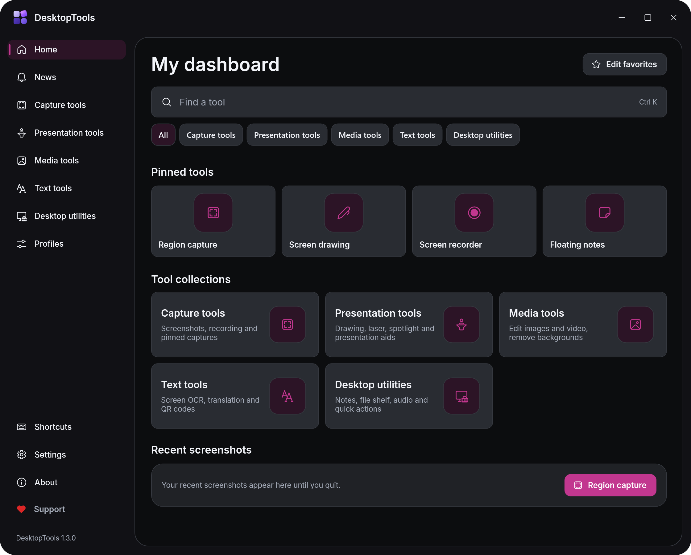
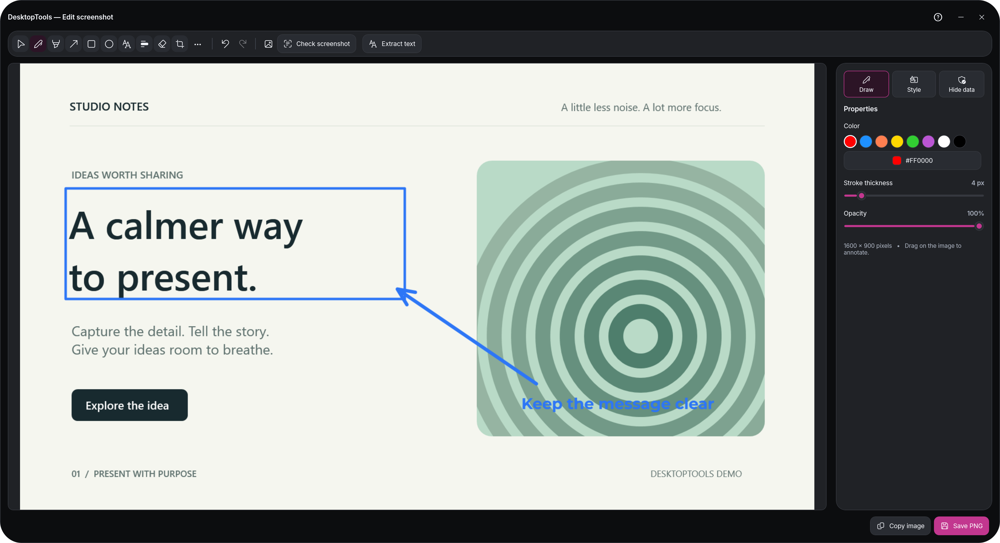
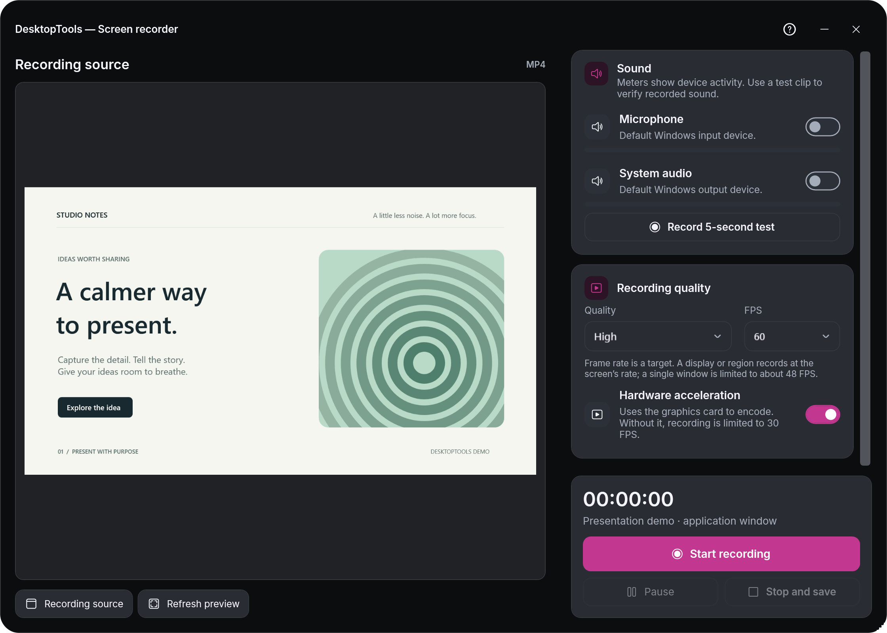

# DesktopTools


[English](README.md) · [Русский](README.ru.md) · [Deutsch](README.de.md) · [Français](README.fr.md) · [Español](README.es.md)

⭐ **Like having your tools in one place? [Star DesktopTools on GitHub](https://github.com/vg2222/DesktopTools) and help more people find it.**


[](https://github.com/vg2222/DesktopTools/releases/latest)
[](LICENSE)
[](docs/security-checks.md)

## Your Windows toolkit for screenshots, recording, presentations, and everyday work.

## 🚀 Get DesktopTools

[**Download for Windows →**](https://github.com/vg2222/DesktopTools/releases/latest) &nbsp; · &nbsp; [Portable version](https://github.com/vg2222/DesktopTools/releases/latest) &nbsp; · &nbsp; [Release notes](https://github.com/vg2222/DesktopTools/releases/latest)

Windows 11 · 64-bit · No separate .NET installation

Security: [SHA-256 checksums](https://github.com/vg2222/DesktopTools/releases/latest/download/SHA256SUMS.txt) · [Verify downloads](docs/security-checks.md)

<sub>The current installer is unsigned; Windows SmartScreen may show a prompt. Install for your user account, with no administrator rights required.</sub>

---

## ✨ One toolkit, fewer apps

**From a quick screenshot to a full walkthrough.** Capture a region, mark the important detail, or record a window with your voice. Switch from showing something to explaining it without assembling a collection of separate apps.

**Keep your audience with you.** Draw over your screen, point with a laser, bring a spotlight to the detail, or stay on track with a teleprompter and timers.

**Clear the small tasks, too.** Read text from a screenshot, translate locally with offline language packs, keep notes nearby, generate a QR code, or crop an image before sharing.

## 📸 Three ways to get started

### 🏠 A home for your everyday tools

Pin what you use most and find the rest in one place.



### ✏️ Explain it in a screenshot

Add arrows, shapes and text, pull the text out of the picture with **Extract text**, then export a copy while preserving your original. Prefer no dialogs? Choose **Clipboard and folder** and every screenshot is copied and saved in one step.



### 🎬 Record the right view

Choose a monitor, window or region and set the sound and quality before recording. Still screens record without freezes or a cut-off ending.



## Optional local AI tools

- **Read text:** keep Windows OCR or download the OCR pack for Latin, East Slavic Cyrillic or Chinese/Japanese text. Scan screen text and Extract text follow your choice.
- **Transcribe recordings:** the video editor's Transcript tab makes searchable, editable timed lines with Fast or Accurate speech models. Save SRT, VTT or text; an MP4 export can have a separate caption file matched to its edits.
- **Improve images:** an optional background quality pack adds finer masks, with Restore/Erase touch-up. The optional face finder suggests faces to cover in Check screenshot; you decide what to hide.
- **Names and hidden details:** turn on Smart screenshot names based on the app and window title, or tick Remove hidden details when exporting an image copy. Both leave the original unchanged and need no model download.

AI runs on the processor, or on the graphics card for text detection and speech recognition when you choose it and Windows has DirectML 1.15 or later. Translation now handles up to 20,000 characters with progress and improved sentence decoding. See [models, measurements and limits](docs/ai-models.md) and [1.3.0 release notes](docs/releases/1.3.0.md).

## 🔒 Local-first by design

No account. No telemetry. No cloud processing of your content. Images, recordings, notes and text stay on your PC. Optional models download only when you request them and accept the publisher’s licence. Downloads use the publisher’s URL at a pinned revision and are checked for size and SHA-256; the download host can see your IP address. The bundled background model and English–Russian translation remain available without an optional download.

You choose where to save images and recordings. Automatic update checks contact GitHub for release information; they do not upload your media or notes. Change the check interval or turn automatic checks off in **Settings → Updates**. The new **News** page can check this repository for announcements once an hour; its automatic checks have a separate switch. Security notices never install updates without your confirmation.

Recorder controls, drawing controls, notifications, floating notes and the teleprompter start hidden from supported captures. Drawings and audience effects remain visible. Adjust individual tools in **Settings → Privacy**. Capture exclusion depends on the recording or sharing app—check the receiving view before relying on it.

## ⚙️ Make it yours

1. Install DesktopTools or extract the portable ZIP, then open the app.
2. Choose your appearance, tools and screen-sharing preferences in the first-run setup.
3. Pin your favorite tools and customize their shortcuts.

DesktopTools stays in the notification area when you close its main window. Click its tray icon to reopen it; choose **Quit** from the tray menu to exit.

| Action | Default shortcut |
| --- | --- |
| Draw / interact | Ctrl + Alt + D |
| Capture a region | Ctrl + Alt + S |
| Show / hide drawing controls | Ctrl + Alt + H |
| Laser pointer | Ctrl + Alt + L |
| Spotlight | Ctrl + Alt + O |
| Freeze frame | Ctrl + Alt + F |

The **Shortcuts** page lists all feature bindings. Default bindings are enabled; optional bindings start disabled. Every binding has its own switch.
If shortcuts do not respond, check that DesktopTools is running in the tray and that the shortcut's switch is on. If the Shortcuts page reports a conflict, choose another combination or close the app using it, then select **Retry shortcuts**. To test which enabled combinations Windows will accept, quit DesktopTools from the tray and run `powershell -NoProfile -ExecutionPolicy Bypass -File .\scripts\diagnose-shortcuts.ps1` from a repository checkout. The script reads only shortcut preferences and changes nothing.

Use **Diagnostics** to check native components, Windows OCR languages and shortcut conflicts. Search in **Settings** to jump straight to one tool's settings page.

## 💡 A few details

Screen recording, offline translation and image background removal need Microsoft Visual C++ x64 Redistributable; recording also needs Windows Media Foundation. Other image tools and screen OCR remain usable without the Visual C++ runtime. Recording rates up to 144 FPS are targets; actual performance depends on the source, encoder and hardware. See [compatibility](docs/compatibility.md) for capture limitations and current testing coverage. Setup checks the runtime and offers the Microsoft download page when needed.

The app speaks **12 languages** (English, Russian, German, French, Spanish, Ukrainian, Simplified Chinese, Portuguese, Japanese, Polish, Turkish and Italian), plus light, dark and system appearance. Text tools offer [20 offline translation languages](docs/offline-languages.md), with English–Russian bundled. Compatible Windows languages appear first; Windows OCR uses installed recognizers, and the optional OCR pack supplies its own alphabets.

<details>
<summary><strong>🛠️ Build and contribute</strong></summary>

Use Windows 11 x64 and the .NET SDK pinned in [global.json](global.json). Fetch the checksum-pinned translation models, then build:

```powershell
./scripts/fetch-translation-models.ps1
./scripts/build.ps1
```

See [Contributing](CONTRIBUTING.md) for running checks and proposing changes, [Architecture](docs/architecture.md) for the project structure, and [Updates](docs/updates.md) for release packaging.

</details>

## ⭐ Help make DesktopTools better

If DesktopTools earns a place on your desktop, [give it a star](https://github.com/vg2222/DesktopTools). Found something that needs attention? [Report a bug](https://github.com/vg2222/DesktopTools/issues/new?template=bug_report.yml) or [request a feature](https://github.com/vg2222/DesktopTools/issues/new?template=feature_request.yml).

Every app feature is free. If you’d like to make a voluntary donation, [support DesktopTools](https://www.desktoptools.cc/support/).

[MIT License](LICENSE) · [Third-party notices](THIRD-PARTY-NOTICES.md) · [Security policy](SECURITY.md)
